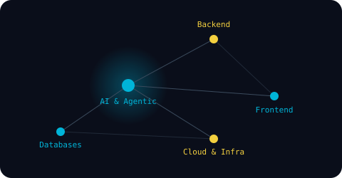

 

# Alejandro Campo
### Software Engineer · AI-First

 

  

Python, FastAPI, and SQL on the backend, Next.js and React on the front —
with Claude Code, Codex, and AWS's own AI running through all of it.

Santa Marta, Colombia · Remote

 

[LinkedIn](https://www.linkedin.com/in/alejandro-campo744622274) · [Email](mailto:alexpabon3799@gmail.com) · [WhatsApp](https://wa.me/573105481182)

 

